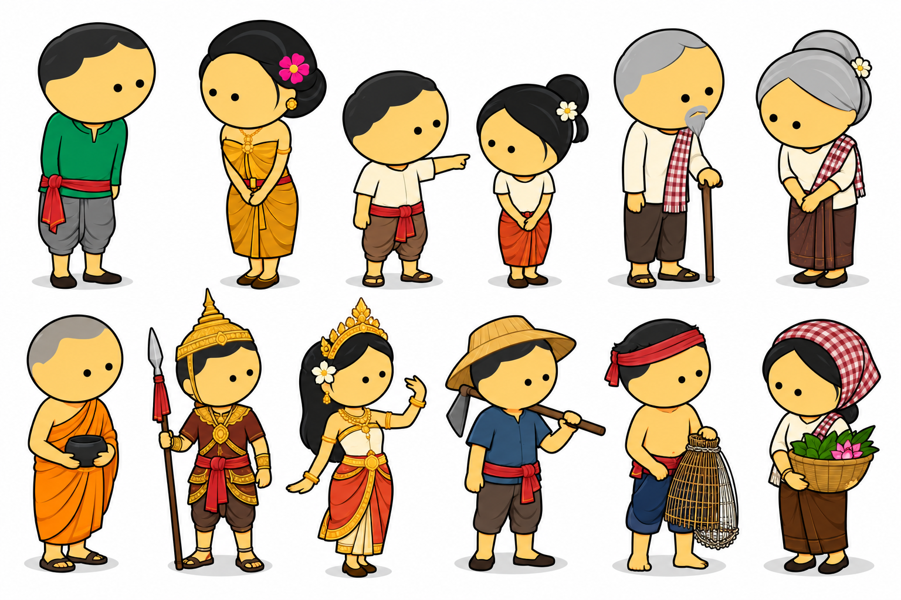

# khmer-2D-animations-v2

**Khmer 2D Character Animation & Video Builder.** Turn a Khmer (or English) story into a finished
Cambodian 2D cartoon. The characters are cute chibi Khmer figures that stay identical in every shot. Each one speaks in its
own locked Khmer voice (VoxCPM2), with lip-sync, camera moves, sound effects, ambience, original Cambodian-inspired
music, and Khmer + English subtitles.

It works as a **Claude Code skill**: ask Claude *"make a Khmer cartoon of …"* and it runs the whole
pipeline. You can also run every step yourself from the command line.



## Features

- **Locked character style**: big round heads, dot eyes, clean outlines, warm yellow skin, Khmer clothing
  (sampot, krama, chang kben, monk robes, royal crowns). It includes 12 ready-made characters copied from the
  reference sheet. Characters are vector rigs, so they look the same in every shot.
- **Character sheets**: a turnaround (front, 3/4, side, 3/4 back, back), 10 expressions and 10 poses, including the
  sampeah greeting, bowing, kneeling, walking, running, sitting, pointing, carrying, working and fighting.
- **16 backgrounds**: village, rice field (green and harvest), farm, forest, pagoda, market, palace, throne hall, river,
  lotus pond, mountain, house interior, Angkor, school and town. Each is layered for parallax and has morning, day,
  evening and night lighting.
- **Khmer voices with VoxCPM2** (local, Apple Silicon MPS). Each character's voice is designed once, then every line
  is cloned from that clip, so voices never drift. You can also use a recording of a real voice actor. edge-tts is
  available as a fallback.
- **Khmer lip-sync**: mouth shapes come from the Khmer script (A, E, I, O, U, M/B/P, F/V, L/R, rest) and follow
  the real audio. The mouth only moves for the character who is speaking.
- **Audio**: automatic footsteps and cloth sounds, plus ambience, Cambodian-inspired music (roneat, kong vong, tro,
  khloy and ching colours) and music ducking under speech. The mix is normalized to −16 LUFS.
- **Subtitles**: Khmer (shaped correctly with HarfBuzz/pango) and English. They're burned into the picture,
  written as `.srt` files, and also included as soft subtitle tracks.
- **Production documents**: a scene list, shot list, storyboard with frames, continuity check and audio check.
- **Output**: 1920×1080 H.264 + AAC 48 kHz, plus 9:16 (TikTok, Reels, Shorts) and 1:1 versions.

## Requirements

- macOS (Apple Silicon recommended; tested on an M1 Pro with 16 GB)
- [Homebrew](https://brew.sh)
- Python 3.10–3.12
- About 8 GB of free disk space for PyTorch and the VoxCPM2 model
- [Claude Code](https://claude.com/claude-code), if you want to use it as a skill

## Install

### 1. System packages

```bash
brew install python@3.12 ffmpeg cairo pango
```

### 2. Clone into your Claude Code skills folder

The folder **must** be named `khmer-2d-animation` (the skill's name):

```bash
git clone https://github.com/chydevit/khmer-2D-animations-v2.git ~/.claude/skills/khmer-2d-animation
```

You can clone it anywhere if you only want the command line, but the commands below assume this path.

### 3. Run setup

```bash
~/.claude/skills/khmer-2d-animation/scripts/setup.sh
```

This creates two Python environments inside the skill folder:

| venv | Purpose |
|---|---|
| `.venv` | Rendering: cairocffi, numpy, scipy, soundfile, edge-tts |
| `.venv-vox` | Voices: VoxCPM2 + PyTorch. The ~5 GB model downloads on first run |

The script then checks ffmpeg, cairo, pango and the Khmer font. Every line should show `[ok]`.

To skip the VoxCPM install and use edge-tts voices only (needs internet), run
`SKIP_VOX=1 scripts/setup.sh` instead, and pass `--engine edge` to the voice commands.

## Use it with Claude Code

Open Claude Code in any folder and ask, for example:

> Make a Khmer cartoon of the story "The Rabbit and the Snail" with a grandmother narrator.

> ធ្វើតុក្កតាខ្មែរ រឿង ទន្សាយនិងខ្យង

> Turn this PDF folk tale into a Khmer animated video with English subtitles.

Claude follows the production order: story → character bible → character sheets → voices → storyboard → preview → QC → final MP4.
It shows you the character sheets and the storyboard before the final render.

## Use it from the command line

```bash
SK=~/.claude/skills/khmer-2d-animation
KH="$SK/.venv/bin/python $SK/scripts/kh2d.py"

# 1. new project with characters from the reference sheet
$KH init ~/animation/my_story --title "My Story" --title-km "រឿងរបស់ខ្ញុំ" --cast boy,girl,grandpa,monk

# 2. write the script (start from the example)
cp $SK/assets/example_story.json ~/animation/my_story/story.json
#    edit story.json and characters/character_bible.json

# 3. run everything
$KH all ~/animation/my_story
```

Or run the steps one at a time:

| Command | What it does |
|---|---|
| `init <p>` | Create the project folders, copy the reference image, and start the bible and story |
| `bible <p>` | Fill in missing voice profiles and validate the bible |
| `sheets <p>` | Character turnarounds, expressions, poses, thumbnails and a cast lineup |
| `voices <p>` | Design and **lock** one reference voice per character |
| `dialogue <p>` | Synthesise every line (cached) and build the lip-sync data |
| `plan <p>` | Timeline from the real audio, plus the scene list, shot list and storyboard frames |
| `stills <p> S02_SH01@1.5 …` | Full-resolution test frames and a grid image |
| `audio <p>` | SFX, ambience and music mixed under the dialogue |
| `subs <p>` | `subtitles_km.srt` and `subtitles_en.srt` |
| `render <p> --preview` | Fast 960×540 preview |
| `render <p>` | Final 1920×1080 movie |
| `qc <p>` | Continuity check and audio check |
| `export <p> --formats vertical,square` | 9:16 and 1:1 social versions |
| `all <p>` | All of the above |

Options:
- `--engine edge` uses edge-tts voices instead of VoxCPM2.
- `--force-voice <id|all>` re-designs a locked voice.
- `--no-burn` leaves subtitles out of the picture.
- `--workers N` sets the number of parallel render processes.

## Project output

```
my_story/
├── source/            reference_character.png, original story text
├── story.json         the production script (scenes → shots → beats)
├── characters/        character_bible.json, sheets/, expressions/, poses/, thumbnails/
├── storyboard/        storyboard.md, storyboard_frames/
├── audio/             voices/ (locked), dialogue/, narration/, music/, ambience/, sfx/, mix.wav
├── animation/         lip_sync/
├── subtitles/         subtitles_km.srt, subtitles_en.srt
├── docs/              scene_list.md, shot_list.md, continuity_check.md, audio_check.txt
└── film/              preview.mp4, final_movie.mp4, final_movie_9x16.mp4, final_movie_1x1.mp4
```

## Writing a story

`story.json` lists scenes, shots and beats. A beat can be a line of dialogue (`say`), narration (`narrate`), an
action (`act`: walk, pose, expression, sampeah, kneel…), a camera change, a sound effect or a title card. You never
write timings by hand: they come from the real length of each voiced line.

```json
{"say": "boy", "km": "ជម្រាបសួរ លោកតា!", "en": "Good morning, Grandpa!", "expr": "happy"}
```

See:
- [`references/story-format.md`](references/story-format.md): the full format and every pose, expression, background,
  camera move, music mood and sound effect
- [`references/character-bible.md`](references/character-bible.md): designing characters (clothing, hair, props, royalty, monks)
- [`references/voices.md`](references/voices.md): voice design, cloning a real voice, and fixing pronunciation
- [`assets/example_story.json`](assets/example_story.json): a complete 4-scene example, "The Lotus Offering"

## Speed (M1 Pro)

| Step | Time |
|---|---|
| VoxCPM2 model load | ~1–1.5 min per run |
| Each voiced line | ~5–60 s |
| Preview render (51 s film) | ~10 s |
| Final 1080p render (51 s film) | ~25 s |

Everything is cached, so after an edit only the changed lines and video chunks are redone.

## Limitations

- The voices are AI-generated. Have a **native Khmer speaker** check the dialogue and pronunciation before you publish.
- Lip-sync matches mouth shapes to the Khmer text and the loudness of the audio; it is not aligned to individual phonemes.
- The music and sound effects are synthesised originals, so there are no copyright issues, but they are simpler
  than live recordings.
- It is built and tested on macOS. Linux should work with system cairo/pango but hasn't been tested.

## Credits

- Voices: [VoxCPM2](https://voxcpm.com/en/) by OpenBMB
- Khmer text shaping: HarfBuzz / Pango
- Fallback voices: Microsoft edge-tts
